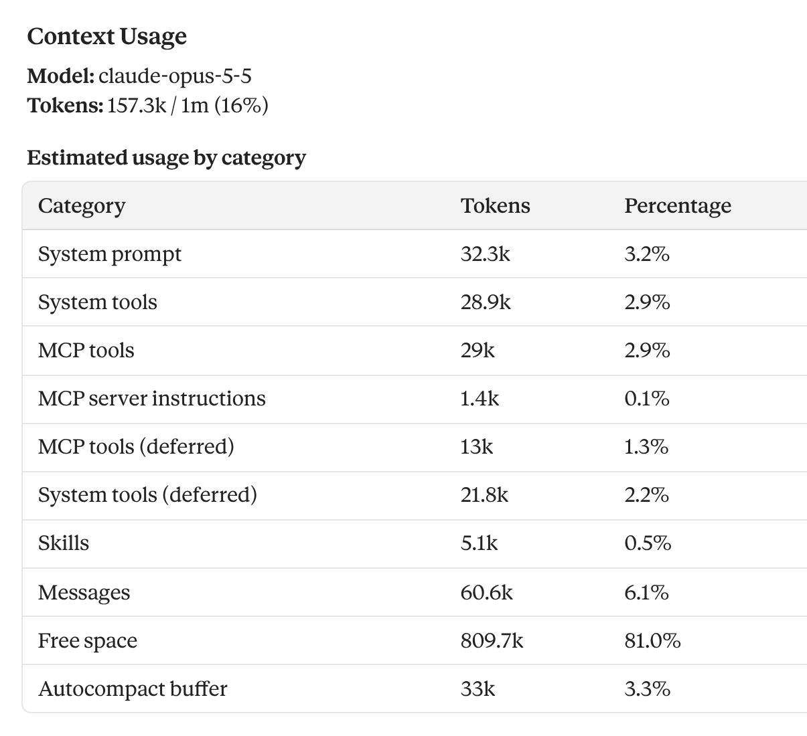
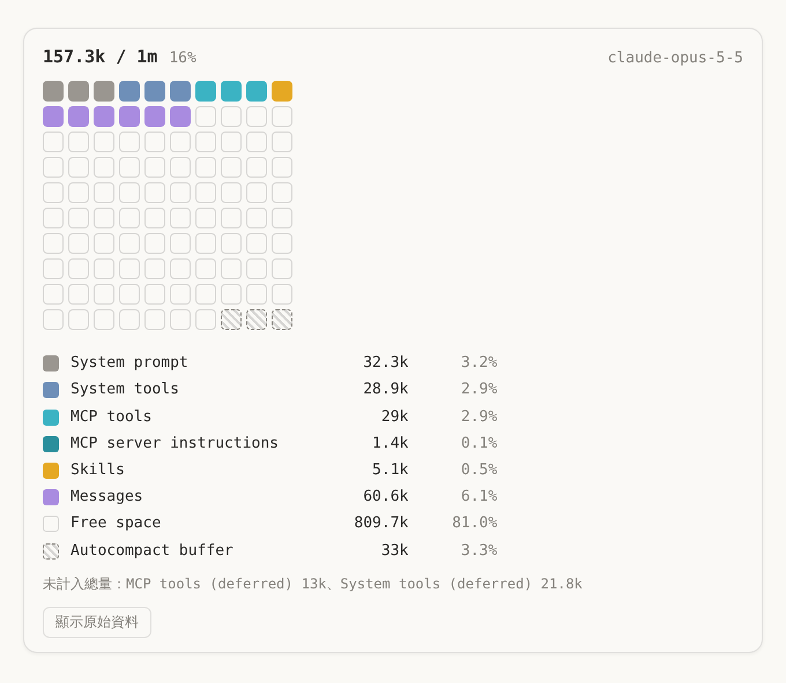
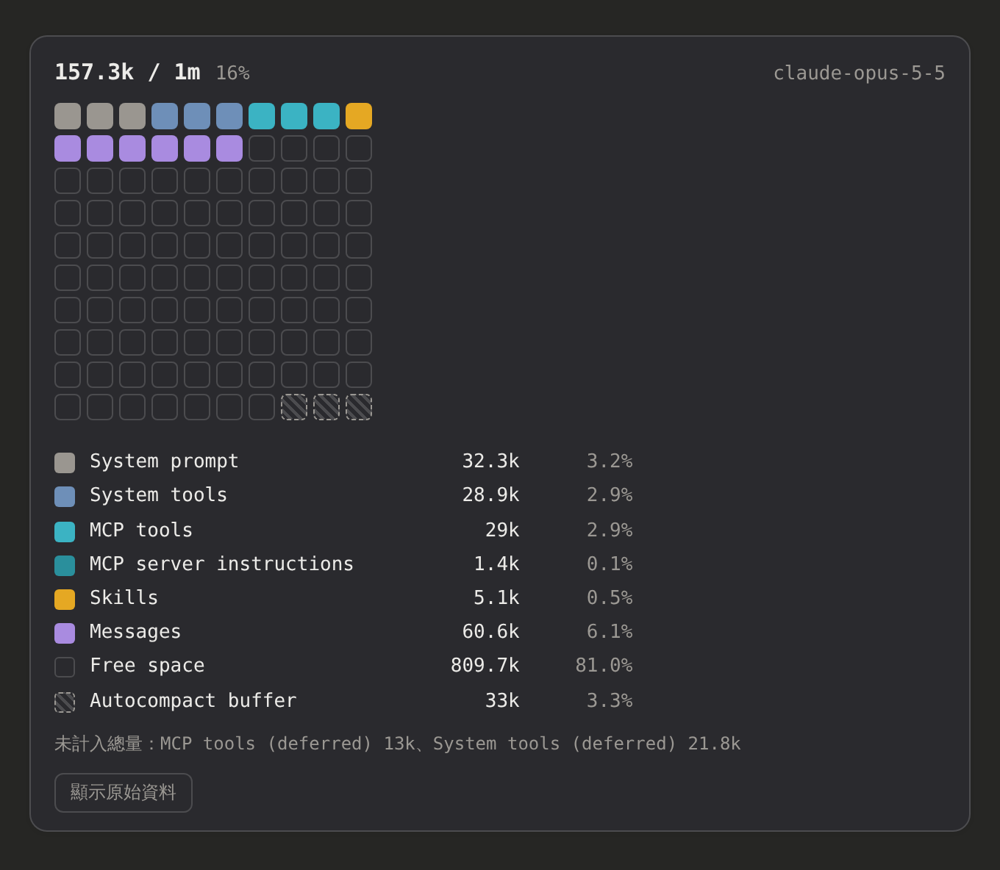

[English](../../#claude-context-usage-grid) **繁體中文** 

# Claude /context 用量方格圖

Tampermonkey 腳本。在 [claude.ai](https://claude.ai) 的 Claude Code 對話裡執行 `/context`，原本的用量表格會自動轉成 10×10 方格圖（每格代表總容量的 1%），一眼就能看出各分類的佔比，以及距離自動壓縮還有多少空間。

## 前後對照

**使用前**：`/context` 輸出的文字表格

**使用後**：方格圖，原始表格預設折疊，點「顯示原始資料」可展開

深色主題會自動切換配色：

## 功能

- **自動處理**：不用按按鈕，`/context` 的輸出一出現就轉換
- **每次查詢各一張圖**：同一個對話裡查了好幾次，每則輸出各自有圖；重新整理頁面或之後再打開對話，也會自動補畫
- **與上一次比較**：從第二次查詢開始，每個分類旁邊會標出跟前一次的差值（例如 Messages +18.2k）
- **壓縮提示**：Messages 比上一次少了 30% 以上時，顯示「中間可能發生過壓縮」
- **Autocompact buffer** 以斜線格表示，是從可用空間裡預留給自動壓縮的區塊
- **deferred 分類另列**：`MCP tools (deferred)`、`System tools (deferred)` 不算在總用量裡，所以不畫進方格，改列在圖例下方
- 原始資料完整保留，只是折疊起來，不會改動或刪除網頁原本的內容

## 安裝

1. 瀏覽器先裝好 [Tampermonkey](https://www.tampermonkey.net/)
2. 點這裡安裝腳本：[Context_Usage_Grid.user.js](https://raw.githubusercontent.com/bgtsai/claude-context-usage-grid/main/Context_Usage_Grid.user.js)
3. 打開 claude.ai 的 Claude Code 對話，輸入 `/context`

腳本有設定自動更新，之後的新版本 Tampermonkey 會自動安裝。

## 說明

- 方格依百分比分配，使用最大餘數法讓總數剛好 100 格。不到半格的分類（例如 0.1%）不會出現在方格裡，只列在圖例中。
- 腳本只讀取頁面上已經顯示的文字，不會攔截網路請求，也不會把任何資料傳到別處。
- 判斷依據是 `/context` 輸出的文字格式，不依賴網頁的 class 名稱，所以網頁改版通常不影響。如果之後 Claude Code 改了 `/context` 的輸出格式，就需要更新解析規則。
